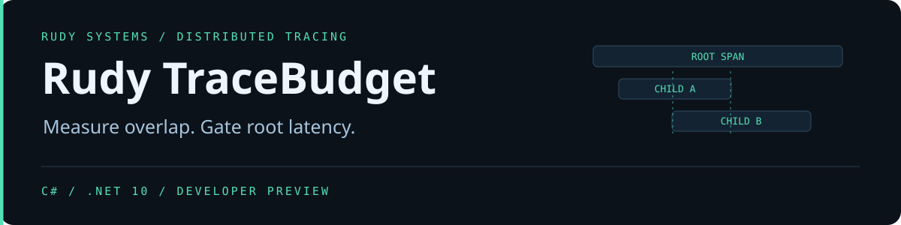

<p align="center"></p>

<p align="center">
<a href="https://github.com/r4venrudy/rudy-tracebudget/actions/workflows/ci.yml"></a>

<a href="LICENSE"></a>
<a href="https://rudy.systems"></a>
</p>

**Parallel child spans can overlap for most of a request. Summing them can make a 50 ms request look like 90 ms of work.** TraceBudget reconstructs parent edges from an OTLP JSON export, measures the union of direct-child intervals, and compares end-to-end root latency by service and operation.

## Run a regression comparison

Download the [preview package](https://github.com/r4venrudy/rudy-tracebudget/releases), compare its SHA-256 to the exact filename in the release manifest, and extract it. The platform package includes a self-contained executable. Python 3.10 or newer generates the synthetic input and runs the test oracle.

```sh
python3 examples/make_traces.py demo
bin/tracebudget inspect --include-labels demo/baseline.json
bin/tracebudget compare --include-labels --max-delta-ns 10000000 demo/baseline.json demo/candidate.json
```

On Windows use `python` and `bin\tracebudget.exe`. The comparison reports a 20 ms p95 increase against a 10 ms budget and exits 1. Raising the budget to 20 ms makes this example pass.

| Evidence | How it is measured |
| --- | --- |
| Covered duration | Union of direct-child intervals clipped to the parent |
| Uncovered duration | Parent duration minus the covered duration |
| Peak children | Maximum concurrent direct-child intervals inside the parent |
| Trace qualification | One root, resolved parents, no parent cycles, and no child extending outside its parent's recorded interval |
| Root latency comparison | Nearest-rank p50 and p95 by exact root service and operation, with a signed p95 delta |

Output is JSON on standard output. Time offsets, durations, and deltas are decimal strings so they retain nanosecond precision in JavaScript and similar consumers. Trace and span IDs, service and operation names, and absolute timestamps are omitted by default. `--include-labels` reveals IDs and names. Review the remaining topology and timings before sharing a report.

## Gate semantics

| Exit | Result |
| --- | --- |
| 0 | Inspection completed, or comparison is within budget |
| 1 | A qualified comparison exceeds the p95 delta budget |
| 2 | Usage, malformed or unsupported input, or I/O failure |
| 3 | Comparison inconclusive |

Comparison defaults to at least 20 samples per service/operation in **both** exports and a permitted p95 delta of zero. A missing route, a small sample, or any topology exclusion makes the overall result inconclusive. Per-route results remain visible. Baseline and candidate durations are separate samples. The comparison does not pair individual trace IDs or compute statistical significance.

## Build and verify

Use the .NET 10 SDK. The C# analysis has no external library dependencies.

```sh
dotnet build src/TraceBudget.csproj -c Release
python3 tests/integration.py "$(command -v dotnet)" src/bin/Release/net10.0/tracebudget.dll
dotnet publish src/TraceBudget.csproj -c Release -r linux-x64 --self-contained true -o stage/bin
```

Use `win-x64` or `osx-arm64` for the other release targets. On Windows pass the absolute path to `dotnet.exe` to the test runner. The oracle independently counts covered and concurrent ticks across generated traces and exercises a 7,500-span chain and full-width integer timestamps.

## Input profile and interpretation

Read one uncompressed OTLP JSON export object with `resourceSpans`, `scopeSpans`, and `spans`. IDs use OTLP hexadecimal encoding. Timestamps accept unsigned decimal strings or integer JSON tokens. One input is limited to 32 MiB, 100,000 spans, and JSON depth 64. Resource `service.name`, span name and status, identities, and times are interpreted. Span links, attributes, events, and protobuf payloads are outside the analysis profile.

Uncovered time measures observed wall-clock coverage. It may include waiting or uninstrumented work. A child outside its parent can reflect clock skew, asynchronous work, or inconsistent instrumentation. TraceBudget keeps those traces visible in inspection and excludes them from the gate. It does not infer causality, CPU time, or missing telemetry from timestamps alone. Compare equivalent sampling and workload conditions.

[OTLP specification](https://opentelemetry.io/docs/specs/otlp/) · [Trace protobuf schema](https://github.com/open-telemetry/opentelemetry-proto/blob/main/opentelemetry/proto/trace/v1/trace.proto)
